# 图形推理与数字推理 · 解题方法手册

> 素材：本库 14 套中国移动笔试真题（2016–2025）的**粉笔官方解析**，共
> 数字推理 90 题、图形推理 125 题、空间重构 33 题。
> 文中的分类统计按解析首句归类，属近似值；例题标注「年份 Q题号」，可在系统里按题号翻到原题与解析。
> 图推例题均配原题截图（docs/images/），截图取自本库题目配图。

---

## 0. 先记住一句话

这两类题的解析几乎都是同一个句式开头：

> 「观察数列，**无明显特征**，优先考虑**多级数列**」
> 「**元素组成相同**，优先考虑**位置规律**」

也就是说——**方法不是想出来的，是从题干特征里"读"出来的**。第一步永远是找特征，第二步才是套方法。
本手册就是按"看到什么 → 用什么法"来组织的。

---

## 一、数字推理

### 1.1 拿到题先扫三个特征

| 你看到的 | 首选手法 | 说明 |
| --- | --- | --- |
| 几乎全是**分数** | 分数数列 | 先看分子、分母能否各自成列，不行就**反约分** |
| 几乎全是**多位数 / 小数** | 机械划分 | 按数位或小数点劈开，左右各成数列 |
| **项数 ≥ 7** | 多重数列 | 奇偶交叉，或两两/三三分组 |
| 数值**起伏平缓** | 作差（多级数列） | 一次不行就二次作差 |
| 起伏约 **2~3 倍** | 递推 / 作商 | 相邻两项有乘除关系 |
| 出现 **25、27、32、64、81、125** 等 | 幂次数列 | 这些是幂次的"路标数" |

### 1.2 本库的题型分布（90 题）

| 类型 | 题数 | 类型 | 题数 |
| --- | --- | --- | --- |
| 递推数列 | 18 | 作和 / 作积 | 5 |
| 多级数列 | 17 | 分数数列 | 4 |
| 幂次数列 | 12 | 基础数列（等差/等比/质数） | 4 |
| 多重数列 | 9 | 因数分解 | 2 |
| 机械划分 | 6 | 作商数列 | 2 |

**结论：递推 + 多级 + 幂次占了七成**，这三类练熟就够应付大多数卷子。

### 1.3 逐类打法（配本库真题）

#### ① 多级数列（17 题）——"无明显特征，就作差"

**动作**：相邻作差 → 差数列还看不出规律 → **再作一次差** → 找到规律后**回代两次**。

> **例：2016 Q24** `0，1，4，11，26，（ ）`
> 一次差：1、3、7、15，仍无规律；
> 二次差：2、4、8，等比（×2），下一项 16；
> 回代：一次差下一项 = 15+16 = 31 → 所求 = 26+31 = **57**。

最容易错的地方是**只回代一次**。二次作差找到规律后，必须把"二次差的值"加回"一次差"，再加回原数列。

> **例：2020秋 Q18** `36，81，131，（ ）`
> 差为 45、50、（55），公差 5 → 131+55 = **186**。这类只需要一次作差。

#### ② 递推数列（18 题）——"前两项造第三项"

**动作**：看第三项能否由前两项的**和、差、积、商**再加一个**修正项**得到。

> **例：2017 Q24** `5，3，7，9，15，23，（ ）`
> 5+3−1=7，3+7−1=9，7+9−1=15，9+15−1=23 → 15+23−1 = **37**
> 修正项是常数 −1。

> **例：2019秋 Q28** `2，4，3，7，16，107，（ ）`
> 2×4−5=3，4×3−5=7，3×7−5=16 → 7×16−5 = **107**
> 这是"乘积型"，数字会突然跳大。

> **例：2020秋 Q25** `1，2，7，20，61，182，（ ）`
> 1×3−1=2，2×3+1=7，7×3−1=20，20×3+1=61 → 修正项 **−1、+1 交替**。
> 修正项本身也可能是数列，这是最容易漏的一层。

> **例：2025 Q12** `2，10，8，10，18，（ ）`
> 出现"起伏不定、忽大忽小"时优先试递推，而不是作差。

#### ③ 幂次数列（12 题）——"看到 64、81、125 就改写"

**动作**：把每项改写成 `底数^指数`，**底数和指数各自成列**；若对不上，加一个**修正项**。

> **例：2016 Q26** `1，32，81，64，25，（ ），1`
> 改写为 1⁶、2⁵、3⁴、4³、5²、**6¹**、7⁰
> 底数 1,2,3,4,5,6,7 递增；指数 6,5,4,3,2,1,0 递减。答案 6。

> **例：2017 Q23** `4，11，30，67，（ ）`
> 4=1³+3，11=2³+3，30=3³+3，67=4³+3 → 5³+3 = **128**
> 这类叫"幂次修正"，修正项是常数。

#### ④ 多重数列（9 题）——"项数多就拆"

**动作**：≥7 项时，先试**奇偶交叉**（奇数项一列、偶数项一列），再试**两两分组**。

> **例：2019 Q20** `2，2，5，4，8，6，11，8，14，10，（ ）`
> 奇数项 2、5、8、11、14、（17）公差 3 → **17**
> 偶数项 2、4、6、8、10 也是等差，只用来干扰。

> **例：2019秋 Q14** `−2、−5、8、9、−14、−13、20、17、−26、（ ）`
> 正负交替出现 → **两两分组**，组内做差或做和找规律。

#### ⑤ 机械划分（6 题）——"多位数/小数就劈开"

> **例：2020春 Q16** `21，59，1117，2325，（ ），9541`
> 劈成 `2|1`、`5|9`、`11|17`、`23|25`、`95|41`
> 左列 2,5,11,23,95；右列 1,9,17,25,41 —— 左右各自找规律。

> **例：2022秋 Q17** `13，210，321，436，555，（ ）`
> `1|3`、`2|10`、`3|21`、`4|36`、`5|55`：左列 1,2,3,4,5；右列 3,10,21,36,55（差 7,11,15,19）。

> **小数同理**：`2.2，4.3，6.5，8.7，10.11` → 整数部分 2,4,6,8,10，小数部分 2,3,5,7,11（质数）。

#### ⑥ 分数数列（4 题）——"分子分母各自成列，不成则反约分"

> **例：2016 Q25**
> 反约分统一后：**后一项分子 = 前一项分子 + 前一项分母**；
> **后一项分母 = 前一项分母 + 后一项分子 + 1**。
> 分子分母互相牵引，是分数数列最典型的"递推"结构。
> 若分母没有递增趋势，**先反约分**再看分子分母关系。

#### ⑦ 作和 / 作积 / 作商 / 因数分解

> **作和**（2020春 Q19）：`2，6，21，43，82，（ ）` —— 作差无规律，改作和；
> **作商**（2018 Q40）：`16，8，24，12，36，18` —— 相邻明显倍数关系，×0.5 / ×3 交替；
> **因数分解**（2016 Q27）：`10，21，44，65` = `2×5`、`3×7`、`4×11`、`5×13`
> 左因子 2,3,4,5 等差，右因子 5,7,11,13 **质数列** → 下一项 6×17 = **102**。
> 因数分解的关键是**认出质数**（5,7,11,13,17,19,23…）。

### 1.4 数字推理速判流程

```
看形态 ──① 全是分数 ──────────→ 分数数列（不成列就反约分）
       ├─② 全是多位数/小数 ──→ 机械划分（数位/小数点劈开）
       └─③ 项数 ≥ 7 ─────────→ 多重数列（奇偶交叉 → 两两分组）

看变化 ──④ 平缓 ─────────────→ 作差 → 不行再作差（记得回代两次）
       ├─⑤ 约 2~3 倍 ────────→ 递推（和差积商 + 修正项）/ 作商
       └─⑥ 跳跃、有幂次路标 → 幂次数列（改写 aⁿ，再加修正项）

以上都不行 ─────────────────→ 作和 / 作积 / 因数分解
```

---

## 二、图形推理

### 2.1 第一步永远是"看元素组成"

粉笔解析的标准开场就是这个判据，它决定了后面全部方向：

| 元素组成 | 优先规律 | 具体考点 |
| --- | --- | --- |
| **相同** | 位置规律 | 平移、旋转、翻转 |
| **相似** | 样式规律 | 叠加、求同、求异、去同存异、黑白运算 |
| **不同** | 属性规律 → 数量规律 | 对称性、曲直性、开闭性；点、线、面、素 |

### 2.2 本库的题型分布（图形推理 125 题）

| 规律 | 题数 |
| --- | --- |
| 数量规律 | 36 |
| 位置规律 | 26 |
| 属性规律 | 24 |
| 样式规律 | 13 |
| 特殊规律（图形间关系等） | 3 |

**数量规律是绝对主力**，而数量规律里最常见的是**线条数**和**交点/封闭区域数**。

### 2.3 逐类打法（配本库真题）

#### ① 位置规律（26 题）——"元素一样，只是动了"

**动作**：先锁定一个特征元素（某个小黑点、某条线），跟踪它的**方向**（顺/逆时针、上下左右）和**步长**（固定、递增、交替）。

> **例：2016 Q47**
> 每列都由白圆、黑五角星、黑方块、白五角星组成；
> 白五角星**上下往返移动，每次 5 格**；
> 白圆形**上下往返，步长 1 格、3 格、1 格交替**。
> 要点：**步长可以交替**，不要只试固定步长。

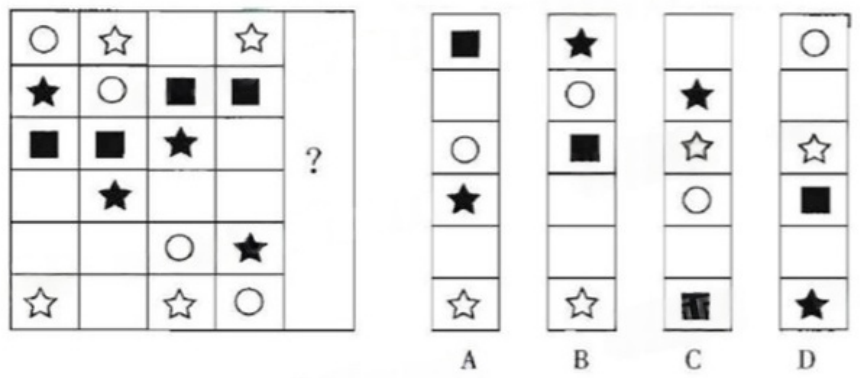

> **例：2017 Q43**（复合规律）
> 斜向左的两条线**顺时针旋转且数量 +1**；斜向右的三条线**顺时针旋转且数量 −1**。

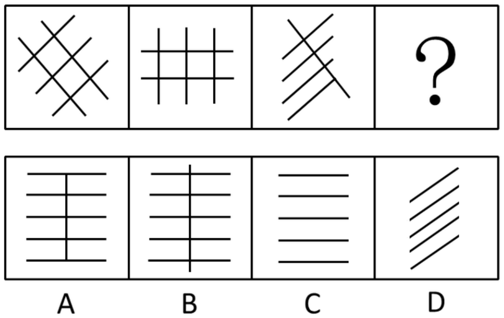

这一类最容易出"位置 + 数量"的**复合规律**：图形在动，数量同时在变。

#### ② 样式规律（13 题）——"元素相似，做加减"

> **例：2016 Q46**
> 第一组图 1 与图 2 **保留两图共有的最长曲线，其余"去同存异"** → 得到图 3。
> 第二组套用同一规则。

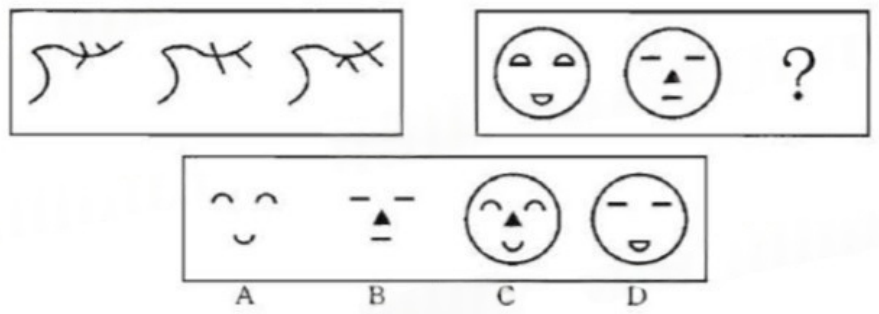

> **例：2018 Q53 / Q54**：题干"元素组成相似，考叠加"，两图直接叠加（可能带黑白运算：黑+白=白 之类）。

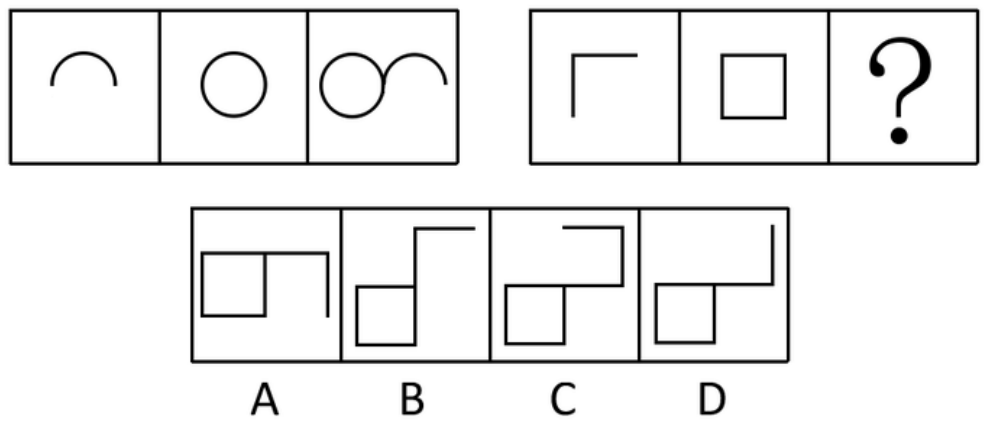

判断顺序：**先试直接叠加，再试去同存异/求同存异，最后试黑白运算**。

#### ③ 属性规律（24 题）——"元素不同，先看对称"

**特征图识别**：出现**箭头、等腰三角形、正多边形、圆**等规整图形，八成考对称性。

> **例：2021 Q31**
> 题干每幅图**既是轴对称又是中心对称**；
> A 项仅中心对称，C、D 仅轴对称，只有 B 项两者兼具。

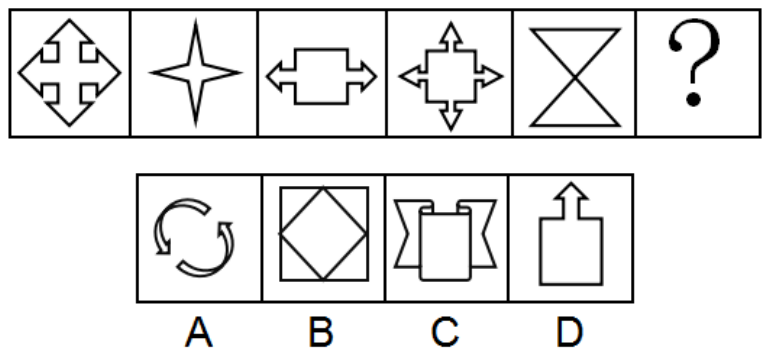

属性规律的三件套：**对称性 → 曲直性 → 开闭性**，按这个顺序试。

#### ④ 数量规律（36 题）——"数一数"

**数什么，按优先级**：直线/曲线数 → 交点数 → 封闭区域（面）数 → 部分数/元素个数。

> **例：2016 Q45**（九宫格，行和恒定）
> 第一行直线条数 6、1、8，和 = 15；第二行 7、5、3，和 = 15；
> 第三行已知 2、4 → 未知应为 **9 条**。

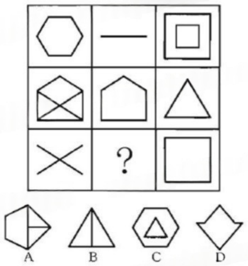

> **例：2017 Q41**
> 第一组直线段数 6、5、4（递减）；第二组前两个 8、7 → 第三个应为 **6**。

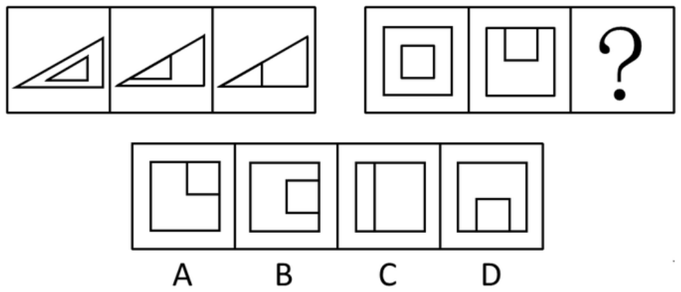

> **例：2021 Q35**（非常规数量）
> 每幅图都有线穿过小黑球，数**线穿过小黑球的个数**：12、13、14、15、16 → 问号处 **17**。

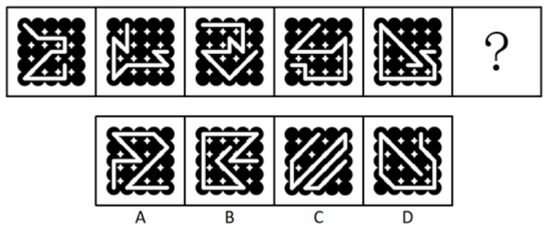

> **要点**：数量规律不一定是"数图形本身的线"，也可以是**线与线、线与元素的交叉次数**。

#### ⑤ 特殊规律（图形间关系）

> **例：2017 Q44**：每个图形由内部两个直角 + 外部两个直角组成；A、B、C 中四个直角**各指一个方向**，D 中只指两个方向 → 选 D。

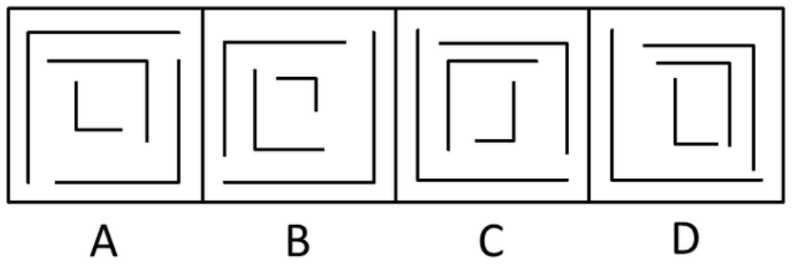

> **例：2017 Q45**：从中心沿线运动，A、B、D 均为**逆时针**，只有 C 是顺时针。

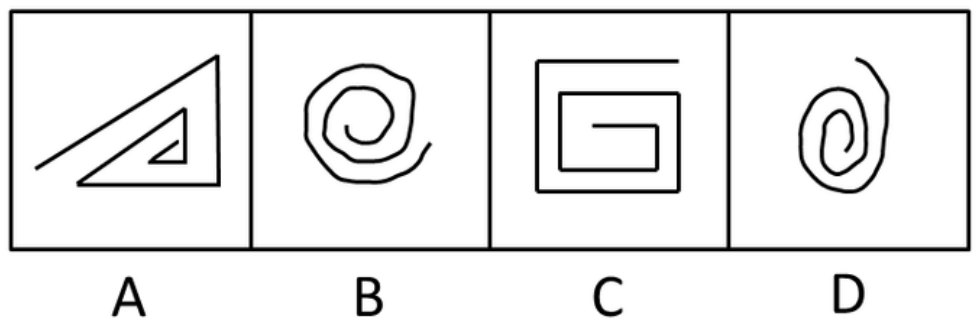

> **例：2018 Q55**：每幅图由若干大小不同的圆组成，**互为相交的圆个数**为 2、3、4 → 选 5 个的。

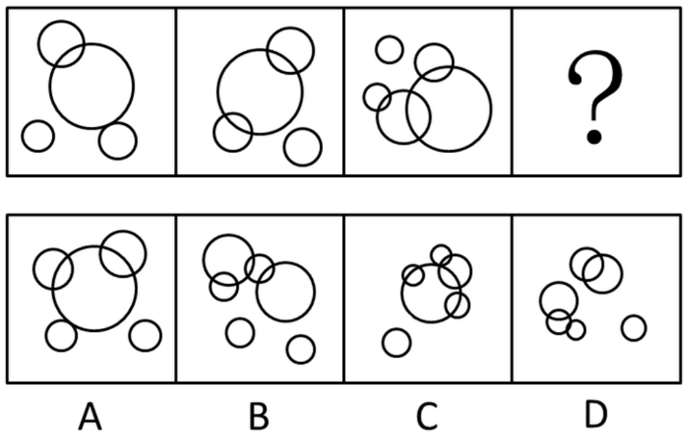

这类题的共性是：**图形本身不重要，重要的是元素之间的关系**（相交、相切、指向、包含）。

#### ⑥ 重组类

> **例：2018 Q51**「把给定图形中的元素重组可以得到的是」
> 元素组成必须**完全一致**：题干有两个标黑点的白三角形、一个网格三角形；A 项没有黑点三角形、B 项只有一个、D 项有两个网格三角形 → 全排除，选 C。
> **方法就是逐元素点数比对 + 排除法**，不需要真的拼。

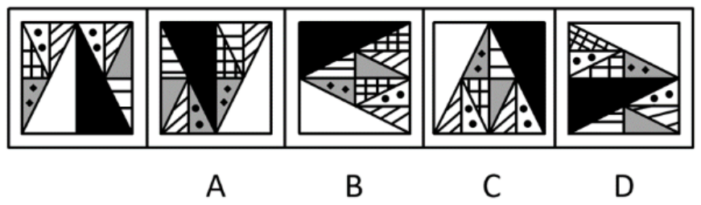

### 2.4 空间重构（33 题）

本库的空间题以**六面体展开图折叠**为主（约 20 题），另有截面图、三视图。

**折叠类三步法**：

1. **找相对面**：展开图中**间隔一个面**的两个面是相对面，立体图中不可能同时看到 → 直接排除含相对面的选项。
2. **看公共边**：相邻两面的公共边上，图案的**朝向/交点**必须与展开图一致。
3. **画边法 / 箭头法**：给某个面固定一个起点顺时针编号，逐条边比对。

> **例：2016 Q44**
> C 项：展开图中面 a 与面 f 是**相对面**，选项中却成了相邻面 → 排除；
> B、D 项：面 b 与面 e 的**公共边**上，展开图中两面的内部线条相交于公共边，选项中不相交 → 排除。

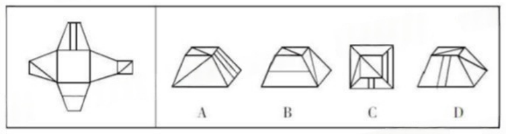

> **例：2022秋 Q62**
> 以黑色三角形的**底边**为基准，看它挨着哪个面；展开图中面 e 黑三角底边挨着面 f，选项中挨的不是 → 排除。

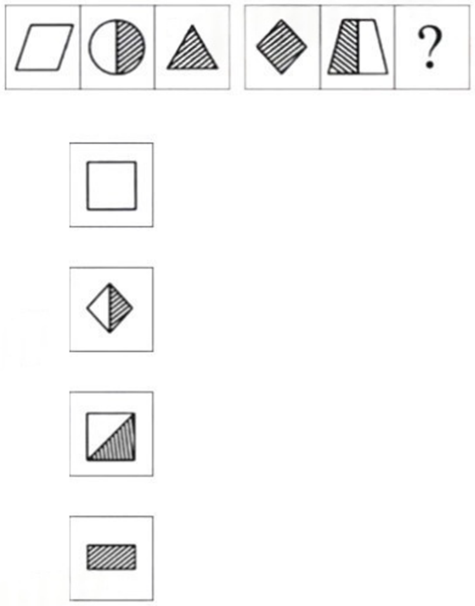

**截面图**（3 题）：想清楚"横切/竖切/斜切"分别能得到什么多边形。

> **例：2022秋 Q51**：横切下半部分可切出十边形；横切上半部分可切出五边形；斜切任意一角可切出四边形；**切不出三角形** → 选 D。

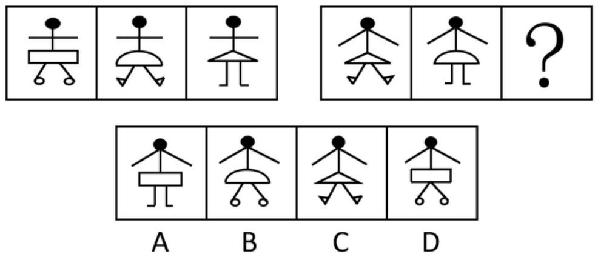

### 2.5 图形推理速判流程

```
元素组成相同 ──→ 位置规律：跟住一个元素，看方向 + 步长（可交替）
元素组成相似 ──→ 样式规律：叠加 → 去同存异 → 黑白运算
元素组成不同 ──→ 属性规律：对称 → 曲直 → 开闭
                └→ 仍不行 ——→ 数量规律：线 → 点 → 面 → 素
都不像         ──→ 特殊规律：相交/相切/指向/包含（图形间关系）
```

---

## 三、两类题共通的四条经验

**1. 解析的第一句就是方法名。**
本库 90 道数字推理里，绝大部分首句直接写"优先考虑多级数列/递推/幂次"。练题时先自己说这句，再对解析——**说对了说明方法对了，算错只是手误**。

**2. 二次规律比一次规律常见。**
数字推理要**回代两次**；图形推理常出现"位置 + 数量"复合。看到规律只对上前半段时，先怀疑还有第二层。

**3. 九宫格可以横着看，也可以竖着看。**
2016 Q45 的官方解析给了两种解法（行和 = 15、列和 = 15），都成立。**一种不通就换方向**。

**4. 能用排除就别硬算。**
图形推理的选项往往只差一个细节（一条线、一个黑点），逐项排除比"求出答案"快得多；数字推理的多位数题也常能靠末位、奇偶性先排除两个选项。

---

## 四、在本系统里怎么练

| 目标 | 入口 |
| --- | --- |
| 专项刷图推/数字推理 | 按题型刷 → 选「图形推理」「数字推理」「空间重构」 |
| 练手感与速度 | 试卷页「冲刺」→ 每题限时 60 秒 |
| 复盘方法掌握情况 | 做题历史 → 复盘，看每题解析与考点 |
| 反复错的类型 | 错题本 → 开始重刷（即时判分） |

刷题时建议**先自己判断题型再动手**：看到数列先在心里说"这是多级还是递推"，看到图形先说"组成相同还是不同"。这个判断动作练熟了，速度提升比多刷几十道题明显得多。

